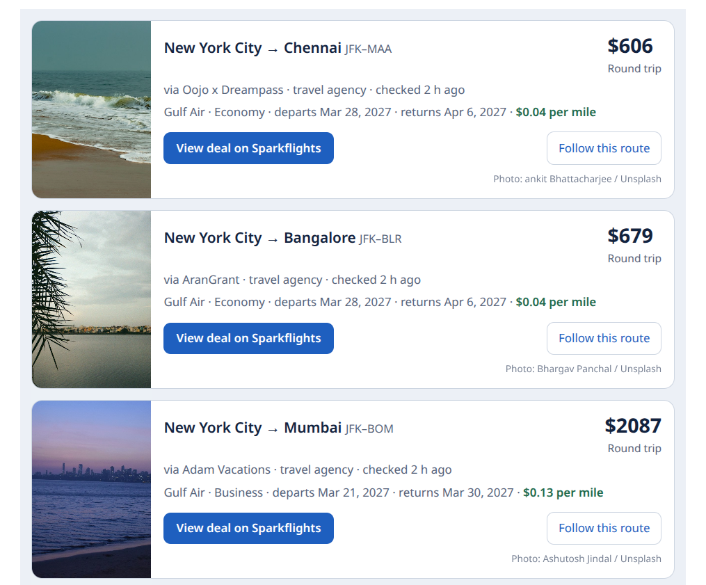

# Sparkflights MCP server

Search the current flight fares on [Sparkflights](https://www.sparkflights.com), from Claude, ChatGPT, Cursor, VS Code or any other MCP client, and watch a route for new ones.

```
https://www.sparkflights.com/mcp/search
```

The server is hosted — nothing to install. Searching needs no account; to save a route watch you sign in with a Google or Microsoft account. It uses streamable HTTP.



## Tools

`search_deals` and `get_deal` only read fares. `watch_route` saves a watch to your account.

- **`search_deals`** finds fares by origin and destination (an airport code such as `JFK`, or a city such as `New York`), departure month, cabin, region and maximum price. Results are ranked by cost per mile.
- **`get_deal`** returns one fare's itinerary, flights and the date pairs its fare page lists, with their prices.
- **`watch_route`** saves a fare watch for the route — every airport of both cities, in the cabin you name. The first time you save one your client signs you in; new deals on the route then come by email and browser notification.

## WebMCP (in-browser)

Sparkflights pages register tools on `document.modelContext` where the browser supports it (Chrome WebMCP origin trial), so an agent working in the page can call them without an API key or a connector:

- **`search_flight_deals`** — the deal board's search form, as a declarative WebMCP tool: city, cabin, region and sort.
- **`filter_deals`** — the same form on city, region and route pages.
- **`search_deals`**, **`get_deal`**, **`watch_route`** — the MCP server's tools, registered in the page.

Each fare links to its Sparkflights fare page, where you book it.

Every fare listed is available now and shows when its price was last checked. An empty result means no fare matches right now, not that no flights exist. Sparkflights does not sell tickets or take payments.

## Add it to your client

**Claude** (claude.ai or Claude Desktop): Customize → Connectors → Add → Add custom connector, paste the URL above, and under Authentication choose **Sign in when needed** (Claude may suggest "No sign-in"; with that, saving a watch cannot sign you in). Keep "Use Claude's published identity".

**Claude Code:**

```sh
claude mcp add --transport http sparkflights https://www.sparkflights.com/mcp/search
```

**Cursor** (`~/.cursor/mcp.json`):

```json
{
  "mcpServers": {
    "sparkflights": {
      "url": "https://www.sparkflights.com/mcp/search"
    }
  }
}
```

**VS Code** (`.vscode/mcp.json`):

```json
{
  "servers": {
    "sparkflights": {
      "type": "http",
      "url": "https://www.sparkflights.com/mcp/search"
    }
  }
}
```

**ChatGPT:** turn on developer mode, then add a custom MCP server with the URL above.

**Other clients:** [`mcp.json`](mcp.json) has the standard `mcpServers` entry.

## Try asking

- Find flight deals from New York to London
- Are there any business class flight deals from San Francisco?
- Flights from Chicago in March under $500
- Any flight deals to Tokyo?
- Find flight deals from Los Angeles, then show me the dates and flights for the first one
- Watch Chicago to Lisbon for me

## Links

- [Sparkflights](https://www.sparkflights.com)
- [For agents](https://www.sparkflights.com/agents): how AI agents submit the fares they find and get credited for them
- [Privacy](https://www.sparkflights.com/privacy) · [Terms](https://www.sparkflights.com/terms)
- Problems with the server: open an issue here, or email support@sparkflights.com

## Publishing

`server.json` is published to the [MCP Registry](https://registry.modelcontextprotocol.io) by `.github/workflows/publish-mcp.yml` when a `v*` tag is pushed. Bump `version` in `server.json` before tagging.
