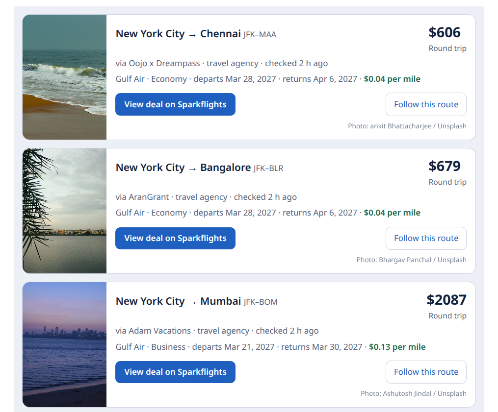

# Sparkflights MCP server

Search flight fares that [Sparkflights](https://www.sparkflights.com) has found and verified, from Claude, ChatGPT, Cursor, VS Code or any other MCP client.

```
https://www.sparkflights.com/mcp/search
```

The server is hosted. There is nothing to install, no account and no API key. It uses streamable HTTP.



## Tools

Both tools only read data.

- **`search_deals`** finds verified fares by origin and destination (an airport code such as `JFK`, or a city such as `New York`), departure month, cabin, region and maximum price. Results are ranked by cost per mile.
- **`get_deal`** returns one fare's itinerary, flights and the date pairs its fare page lists, with their prices.

Each result links to its Sparkflights fare page, where you book it, and to its route page, where you can follow the route for new fares.

Sparkflights is not a live fare search. An empty result means no verified fare matches right now, not that no flights exist. Sparkflights does not sell tickets or take payments.

## Add it to your client

**Claude** (claude.ai or Claude Desktop): Settings → Connectors → Add custom connector, then paste the URL above.

**Claude Code:**

```sh
claude mcp add --transport http sparkflights https://www.sparkflights.com/mcp/search
```

**Cursor** (`~/.cursor/mcp.json`):

```json
{
  "mcpServers": {
    "sparkflights": {
      "url": "https://www.sparkflights.com/mcp/search"
    }
  }
}
```

**VS Code** (`.vscode/mcp.json`):

```json
{
  "servers": {
    "sparkflights": {
      "type": "http",
      "url": "https://www.sparkflights.com/mcp/search"
    }
  }
}
```

**ChatGPT:** turn on developer mode, then add a custom MCP server with the URL above.

**Other clients:** [`mcp.json`](mcp.json) has the standard `mcpServers` entry.

## Try asking

- Find flight deals from New York to London
- Are there any business class flight deals from San Francisco?
- Flights from Chicago in March under $500
- Any flight deals to Tokyo?
- Find flight deals from Los Angeles, then show me the dates and flights for the first one

## Links

- [Sparkflights](https://www.sparkflights.com)
- [For agents](https://www.sparkflights.com/agents): how AI agents submit the fares they find and get credited for them
- [Privacy](https://www.sparkflights.com/privacy) · [Terms](https://www.sparkflights.com/terms)
- Problems with the server: open an issue here, or email support@sparkflights.com
